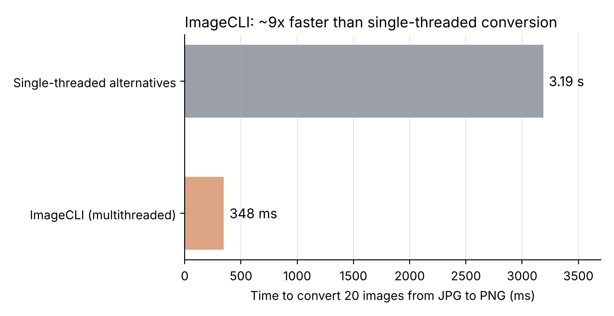

# ImageCLI 
Its an easy to use command line program where you simply type the directory of your target images and the specified format. The program will handle the conversion using rayon for multithreaded parallel CPU work with the memory safety of Rust. 

## Performance

Converting 20 images on the same machine: sequential 3.19 s, ImageCLI 348 ms (about 9x faster).
